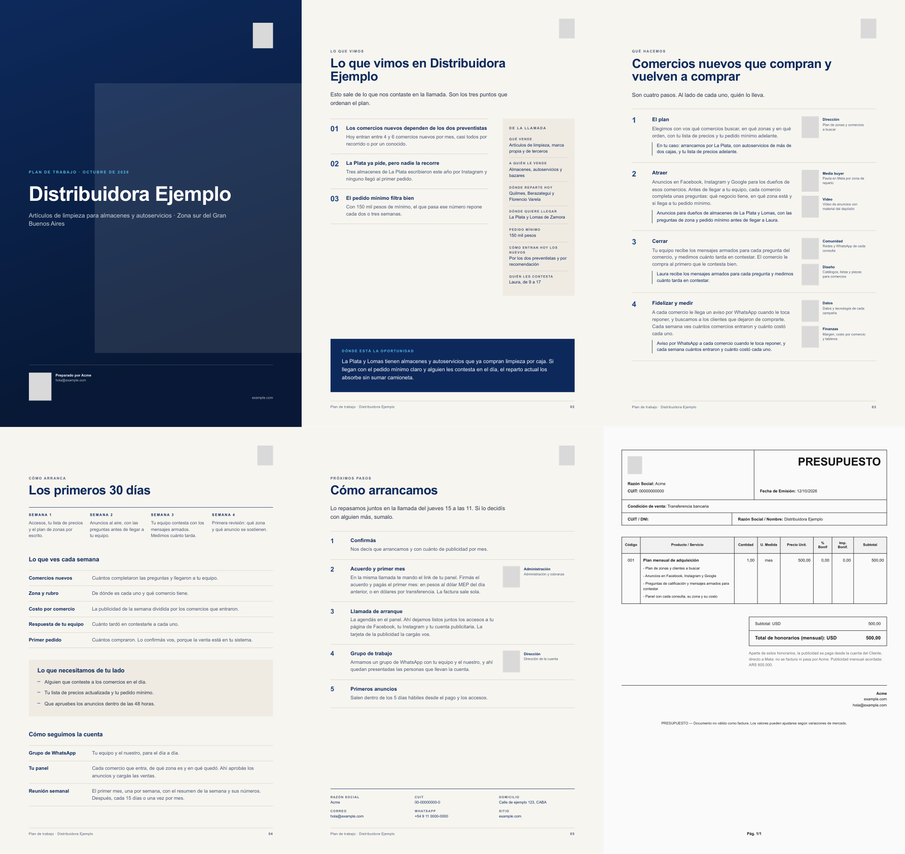

# Call to Proposal

This service turns the transcript of a 20-minute discovery call into a client-ready proposal PDF in a single request.

Claude reads the transcript and returns the proposal fields through a strict tool schema. That covers:

- the client profile,
- three findings, each with the client's own numbers,
- the opportunity,
- the four plan steps adapted to the client,
- the date of the follow-up call,
- internal alerts for the account owner.

The fields fill a branded HTML template, and headless Chromium on Vercel prints it to PDF.

I built it for my growth agency's sales process, where it replaced writing proposals by hand. An Apps Script sends the Google Meet transcript, stores the returned fields in the pipeline sheet and files the PDF in Drive. The documents are in Rioplatense Spanish. In this public copy, the brand, the team, the fiscal data and the price list are placeholders.



`examples/sample-proposal.pdf` was rendered from `examples/sample-fields.json`, which uses a fictional client.

## How it works

1. `POST /api/propuesta-desde-transcripcion` with `{ transcripcion }` and an `x-api-key` header.
2. `lib/propuesta-claude.js` calls Claude with a single tool, `armar_propuesta`. The tool's JSON schema caps the length of every field, so no page overflows.
3. The prompt follows these rules:
   - Nothing is invented. A missing field stays empty.
   - Numbers are kept exactly as the client said them.
   - There are no guarantees and no jargon.
   - The subject of each sentence is the work, never the client's weakness.
4. `lib/propuesta-html.js` fills the `{{TOKENS}}` of `templates/propuesta.html`:
   - It truncates at word boundaries to the same caps.
   - It escapes all text.
   - It builds the quote table from `services.js`.
5. `lib/pdf.js` prints the HTML with `@sparticuz/chromium` and `puppeteer-core`.
6. The response is the PDF, plus an `X-Propuesta-Campos` header (base64 JSON) so the caller can save the structured fields.

Two more endpoints:

- `api/propuesta.js` renders a proposal from fields you already have.
- `api/render.js` is a generic HTML-to-PDF endpoint used by the rest of the document stack (contracts, minutes, onboarding decks).

## Stack

- Node.js (ESM) on Vercel Functions.
- The Anthropic Messages API, with tool use and a JSON schema.
- Headless Chromium through `@sparticuz/chromium` and `puppeteer-core`.
- Google Apps Script on the caller side.

## Run it

```bash
npm install
vercel env add RENDER_API_KEY
vercel env add ANTHROPIC_API_KEY
vercel --prod
```

```bash
curl -X POST https://<your-deployment>/api/propuesta-desde-transcripcion \
  -H "x-api-key: $RENDER_API_KEY" -H "content-type: application/json" \
  -d '{"transcripcion": "...", "formato": "json"}'
```

With `"formato": "json"` the service returns only the extracted fields, which helps when you iterate on the prompt.

Shared for portfolio review. All rights reserved.
